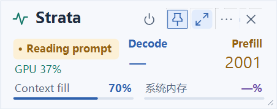
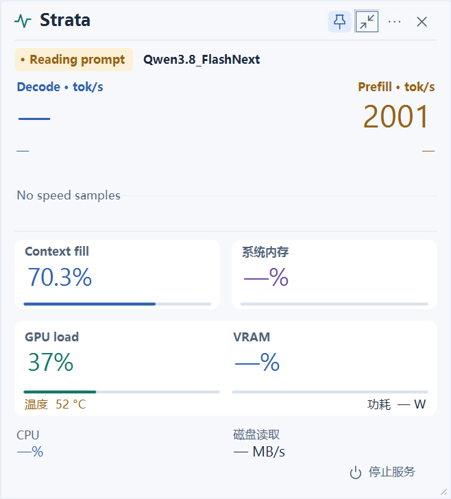
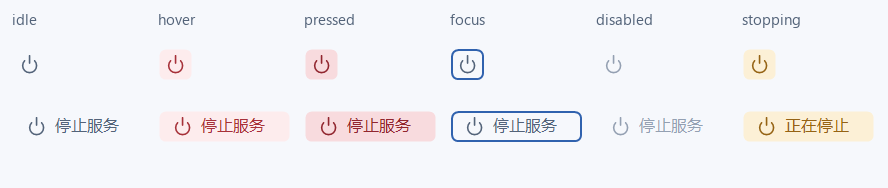

# Strata Monitor

面向本机 Strata 推理服务的 Windows 原生监控器与启动器。使用 C++17、Win32、GDI+ 和 WinHTTP，不嵌入浏览器、WebView、Electron 或 Python GUI。

[下载 v0.5.2](https://github.com/HHFu517/strata-monitor/releases/tag/v0.5.2) · [更新记录](CHANGELOG.md) · [构建与测试](docs/TESTING.md) · [MIT 许可](LICENSE)

这是独立、非官方的配套工具，**不是推理引擎，也不包含 Strata、模型、Python 环境或 GPU 驱动**。目前按下述固定目录结构集成，已在 Strata **v0.1.43.1** 的本机部署中验证；其他版本的接口和目录兼容性尚未确认。

## 界面

下图全部来自隔离模拟服务，仅展示界面与数字排版，**不是推理性能数据**。

**紧凑模式**



**完整模式**



## 功能

- 独立启动页：选择现有 IQ3_XXS / IQ3_S 配置，无终端窗口加载；托管服务真正就绪后进入监控，已有服务可手动接入。
- Decode 与 Prefill 实时速度、同一时间轴的双曲线；Prefill 千位显示完整数字，例如 `2001`。
- Context fill、系统内存、GPU/VRAM、温度与功耗等由 Strata 实际提供的字段；缺失项显示破折号，不自行增加硬件采样器。
- 紧凑/完整视图、独立尺寸记忆、置顶、系统托盘和高 DPI 缩放。
- 明确确认后停止本部署服务；默认“否”，按路径和进程创建时间核验目标，无法验证时拒绝操作。
- 可见时默认 1 秒刷新，隐藏时至少 5 秒；单采样工作线程、持久 HTTP 会话及无变化重绘抑制。

## 下载与安装

### 运行条件

- Windows 10/11 x64；下载包未做代码签名，Windows 可能提示 SmartScreen。
- 已自行安装并能正常运行的 Strata 本机部署；默认接口为 `http://127.0.0.1:517`。
- 启动/停止功能使用下述目录和文件名；托管启动复用 Strata 现有的 Python `.venv`，不创建或更新运行环境。
- 目前只支持无 API 密钥的本机接口，不提供远程主机、鉴权或任意模型预设编辑界面。

下载 Release 中的 `StrataMonitor-v0.5.2-windows-x64.zip`，解压到 Strata 部署根目录，形成：

```text
<StrataRoot>/
  app/
    .venv/Scripts/python.exe
    engine/strata.exe
    serve/server.py
    strata-iq3_xxs.json
    strata-iq3_s.json
  monitor/
    StrataMonitor.exe
    background_host.py
    LICENSE
    THIRD-PARTY.md
    vendor/                  # 第三方许可文本
```

运行 `monitor/StrataMonitor.exe`。程序以其所在目录的上一级作为 Strata 根目录；**不要只把 EXE 随意放到其他目录后尝试启停服务**。缺少 Python、Host、脚本或预设配置时会拒绝启动，不会自动安装。

升级前只需退出 Monitor，再替换发布文件。**保留已有 `monitor.ini`，不必停止模型服务。** ZIP 不包含个人 INI、启动记录或模型配置。

Release 附带 `SHA256SUMS.txt`。可使用 PowerShell 核对 ZIP 的 SHA256；哈希用于检查下载完整性，不等于代码签名：

```powershell
Get-FileHash ./StrataMonitor-v0.5.2-windows-x64.zip -Algorithm SHA256
```

### 启动与关闭的区别

- 每次打开先显示启动页；已有就绪服务点击“进入监控”，不会因为打开 Monitor 而重启模型。
- 托管启动不自动打开网页（不受 `open_browser=true` 影响）；需要时从菜单选择“打开网页”。原 CLI 行为不变。
- 右上角 **×**、Esc、Alt+F4 只收进托盘。
- **Ctrl+Q / 退出界面，后台继续** 只退出 GUI，不发起新的 Stop。此前已经确认的停止清理仍可继续完成。
- **停止服务** 才会在确认后清理后台；这会丢失模型缓存，也可能中断请求。
- 外部终端实例只识别本部署 `server.py` 和精确引擎路径。共享终端存在未知成员时不广播 Ctrl+C；端口所有者改变或身份无法确认时拒绝继续。
- 对外部实例，确认即授权本次正常中断、请求卸载以及必要时对已核验残留进行定向结束；不按名称全局强杀，不调用其他启动器的清端口逻辑。

Stop 默认无框，悬停/按下使用浅红提示，键盘焦点为圆角描边，停止中为琥珀色：



## 快捷键与参数

| 操作 | 快捷键 |
|---|---|
| 置顶 | Ctrl+T |
| 紧凑/完整切换 | Ctrl+M |
| 立即刷新 | F5 |
| 收进托盘 | Esc / Alt+F4 |
| 退出 GUI、后台继续 | Ctrl+Q |

```powershell
./StrataMonitor.exe --port 517
./StrataMonitor.exe --compact
./StrataMonitor.exe --no-settings
```

默认完整窗口 480×692 DIP、最小 360×552；紧凑窗口默认 480×156、最小 360×144。UTF-16 `monitor.ini` 在程序同目录自动生成；启动页与两种监控视图分别记忆几何设置。

## 数据口径与边界

- 蓝色 Decode 与琥珀色 Prefill 共用时间轴，但各自缩放纵轴；空值断线，真实零保留。
- Context fill 是请求输入加生成 token 的口径，**不是精确 resident KV 占用**。内存是系统 RAM，不是 Strata 进程独占内存。
- 空闲不把上次速度伪装成实时速度。GPU 信息完全取决于 Strata 返回的遥测。
- 常规采样只 GET `/metrics`；已确认的外部 Stop 可调用现有 POST `/unload`，不新增 HTTP 控制端点。
- 本工具不改模型、上下文、推测解码、prefill、vision 或 GPU 配置，不安装服务、自启项、驱动或新运行时。
- 短时资源观测不能证明长期无泄漏、零 GPU 开销或推理吞吐提升；不作这类保证。

## 从源码构建

需要已有的 **PowerShell 7、MSVC x64 C++ 工具和 Windows SDK**。第三方 JSON 头文件已随源码提供；构建脚本不会下载或安装工具链。

```powershell
git clone https://github.com/HHFu517/strata-monitor.git
cd strata-monitor
pwsh -NoProfile -File ./Build.ps1 -Tests
```

脚本通过 Visual Studio Installer 的 `vswhere` 查找现有工具链；也可以指定：

```powershell
pwsh -NoProfile -File ./Build.ps1 -Tests -VcVars 'C:/path/to/vcvars64.bat'
```

输出为根目录 `StrataMonitor.exe`。安装时仍需将 EXE 和 `background_host.py` 放入上面的 `monitor/` 目录，并保留第三方许可。

HTTP 测试只需标准 Python，无额外包：

```powershell
python ./tests/network_test.py
```

可复现检查、已验证范围和未测试项见 [TESTING.md](docs/TESTING.md)。实现分层见 [DESIGN.md](DESIGN.md)。

## 隐私与许可

仓库和 Release 不包含模型、Strata 引擎、个人配置、API 凭据、日志或本机进程记录。监控器本身不保存提示词和回答正文；托管日志可能包含 Strata 的标准输出，提交 issue 前请先检查并脱敏。不要公开 `monitor.ini`、`logs/` 或 `run/`。

Monitor 自有代码使用 [MIT](LICENSE)。nlohmann/json 与 Lucide 保留各自许可，见 [THIRD-PARTY.md](THIRD-PARTY.md)；Strata、模型、系统字体和驱动不在本项目许可范围内。
